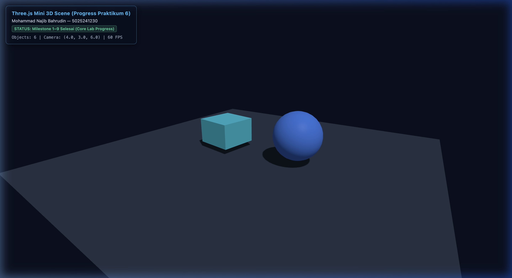

# Laporan Progress Praktikum 6 — Introduction to Three.js

**Mata Kuliah:** EF234504 — Grafika Komputer  
**Pertemuan:** 6 — Introduction to Three.js  
**Nama Mahasiswa:** Mohammad Najib Bahrudin  
**NRP:** 5025241230  
**Dosen Pengampu:** Dr. Darlis Herumurti  
**Departemen:** Teknik Informatika — Institut Teknologi Sepuluh Nopember  

---

## 1. Status & Deskripsi Progress
Branch `progress` ini merepresentasikan **progres pengerjaan inti sesi praktikum di laboratorium** yang mencakup penyelesaian berurutan dari **Milestone 1 hingga Milestone 10**.

Fokus utama pada tahap progres ini adalah memahami abstraksi dasar Three.js di atas WebGL tanpa menambahkan fitur tantangan (*challenge*) mandiri:
* Mengelola scene 3D dengan **2 bentuk geometri utama** (*Cube* dan *Sphere*) yang berdiri di atas bidang lantai (*Ground Plane*).
* Mempelajari perbedaan respons material (*Lambert Diffuse* vs *Phong Specular*).
* Menerapkan sistem pencahayaan ganda (*AmbientLight* dan *DirectionalLight*) serta rantai konfigurasi *Shadow Mapping*.
* Mengimplementasikan *animation loop* berbasis *Delta Time* (`THREE.Clock`) agar pergerakan objek independen terhadap *refresh rate* layar.

---

## 2. Screenshot Tampilan Progress

Berikut adalah bukti tangkapan layar tampilan scene progres saat ini:



---

## 3. Poin-Poin Milestone yang Telah Diselesaikan

| No. | Milestone | Deskripsi Implementasi |
|:---:|:---|:---|
| 1 | **Milestone 1 — Setup Project** | Inisialisasi project berbasis Node.js + Vite dengan instalasi dependency `three`. Struktur project dan baseline HTML/CSS terhubung bersih tanpa error console. |
| 2 | **Milestone 2 — Scene, Camera & Renderer** | Pembuatan `THREE.Scene()` dengan warna background `#0b1020`, inisialisasi `PerspectiveCamera` (FOV: $60^\circ$, near: $0.1$, far: $100$) dengan `lookAt(0, 0.5, 0)`, serta penyiapan `WebGLRenderer` dengan `antialias: true`. |
| 3 | **Milestone 3 — Objek 1: Cube** | Penambahan geometri kubus menggunakan `THREE.BoxGeometry(1, 1, 1)` dengan `MeshLambertMaterial` berwarna cyan `#22d3ee`. |
| 4 | **Milestone 4 — Transformasi Objek** | Menerapkan translasi posisi `(-1.2, 0.6, 0)`, rotasi sumbu Y `Math.PI / 4`, dan skala non-uniform `(1.2, 0.8, 1.2)` pada kubus. |
| 5 | **Milestone 5 — Objek 2: Sphere** | Penambahan geometri bola menggunakan `THREE.SphereGeometry(0.7, 32, 16)` dengan `MeshPhongMaterial` (warna biru `#4488ff`, `shininess: 60`) untuk mengamati titik kilau pantulan (*specular highlight*). |
| 6 | **Milestone 6 — Ground Plane** | Penambahan lantai menggunakan `THREE.PlaneGeometry(10, 10)` yang dirotasi horizontal $-90^\circ$ pada sumbu X dengan `MeshLambertMaterial` abu-abu gelap `#334155`. |
| 7 | **Milestone 7 — Pencahayaan (Lighting)** | Penambahan `AmbientLight` (intensitas $0.35$) untuk penerangan dasar dan `DirectionalLight` (intensitas $2.0$) pada posisi $(3, 5, 2)$ sebagai sumber cahaya terarah utama. |
| 8 | **Milestone 8 — Shadow Mapping** | Mengaktifkan `renderer.shadowMap.enabled = true`, mengonfigurasi `directionalLight.castShadow = true` (resolusi $1024 \times 1024$), mengaktifkan `castShadow` pada kubus dan bola, serta `receiveShadow` pada ground. |
| 9 | **Milestone 9 — Animation Loop & Delta Time** | Pembuatan loop `requestAnimationFrame` dengan `THREE.Clock`: kubus berputar kontinu (`0.8 * delta`), bola berputar (`0.5 * delta`), dan bola bergerak melayang vertikal secara sinusoidal ($y = 0.75 + \sin(2.0 \cdot t) \times 0.15$). |
| 10 | **Milestone 10 — Responsive Rendering** | Event listener `resize` yang secara dinamis memperbarui `camera.aspect`, memanggil `camera.updateProjectionMatrix()`, dan menyesuaikan `renderer.setSize()` tanpa distorsi. |

---

## 4. Poin-Poin Backlog / Tugas Lanjutan (Belum Dikerjakan di Branch Ini)

Fitur-fitur berikut merupakan bagian dari tugas akhir mandiri dan tantangan (*Challenge* Poin 82–90):
- [ ] **Challenge A (Tambah Geometri):** Belum menambahkan `CylinderGeometry`, `ConeGeometry`, atau `TorusGeometry`.
- [ ] **Challenge B (Material Gallery):** Belum menjajarkan perbandingan material `MeshBasicMaterial` dan `MeshStandardMaterial` PBR.
- [ ] **Challenge C (Dual Camera Mode):** Belum mengintegrasikan toggle tombol `P` untuk beralih ke `OrthographicCamera`.
- [ ] **Challenge D (Animasi Lampu):** Belum menggerakkan posisi `DirectionalLight` secara memutar/orbit.
- [ ] **Challenge H (Kontrol Objek Interaktif):** Belum mengaktifkan input keyboard panah dan `Q`/`E` untuk memindahkan kubus secara manual.
- [ ] **Dashboard HUD Telemetri:** Tampilan HUD saat ini masih berupa badge status progres lab sederhana di pojok kiri atas.

*(Catatan: Seluruh tantangan dan backlog di atas telah diimplementasikan secara terpisah pada branch `main`)*.

---

## 5. Cara Menjalankan

```bash
# Masuk ke folder praktikum 6
cd "praktikum 6"

# Pastikan berada di branch progress
git checkout progress

# Install dependency
npm install

# Jalankan development server
npm run dev
```

Buka URL lokal yang muncul pada terminal (biasanya `http://localhost:5173/`).

---

## 6. Catatan Debugging

1. **Orientasi Ground:** Secara default `PlaneGeometry` menghadap ke sumbu Z. Harus dirotasi pada sumbu X sebesar $-90^\circ$ (`-Math.PI / 2`) agar menjadi lantai horizontal di bawah kubus dan bola.
2. **Ketergantungan Shadow:** Bayangan hanya akan muncul di lantai jika seluruh rantai aktif:
   $$\text{Renderer (shadowMap)} \to \text{Light (castShadow)} \to \text{Mesh (castShadow)} \to \text{Ground (receiveShadow)}$$
3. **Penyelarasan Delta Time:** Nilai `clock.getDelta()` dibatasi dengan `Math.min(..., 0.05)` untuk mencegah lonjakan posisi ekstrem saat tab browser dibuka kembali setelah diminimalkan.

---

## 7. Refleksi Praktikum

1. **Perbedaan WebGL Manual vs Three.js:** Penggunaan Three.js secara dramatis mengurangi penulisan kode boilerplate yang rumit pada WebGL murni (seperti inisialisasi VAO/VBO dan kompilasi shader GLSL), memungkinkan fokus lebih cepat pada komposisi objek dan pencahayaan 3D.
2. **Abstraksi Paling Membantu:** Konsep `Mesh = Geometry + Material` adalah abstraksi Three.js paling intuitif karena mengemas koordinat lokal, normal vektor, dan pipeline shading ke dalam satu objek yang mudah dikontrol transformasinya.
3. **Hubungan Geometry dengan Vertex Data:** `BufferGeometry` Three.js sebenarnya memetakan langsung atribut data vertex (`position`, `normal`, `uv`) ke memori GPU dalam format `Float32Array`.
4. **Hubungan Material dengan Shader/Lighting:** Material seperti `MeshPhongMaterial` secara otomatis meng-compile vertex dan fragment shader WebGL di belakang layar dengan rumus pencahayaan Ambient, Diffuse, dan Specular Blinn-Phong.
5. **Konfigurasi Shadow yang Mudah Terlupa:** Mengaktifkan bayangan membutuhkan aktivasi simultan pada renderer, light, caster objek, dan receiver bidang; jika satu konfigurasi terlewat, bayangan tidak akan ter-render.
6. **Manfaat Delta Time:** Delta time menjamin bahwa kecepatan perpindahan dan rotasi grafika sepenuhnya independen terhadap fluktuasi frame rate perangkat pengguna (stabil pada 30Hz, 60Hz, maupun 144Hz).
7. **Masalah Debugging:** Mengatur batas volume frustum kamera bayangan (`directionalLight.shadow.camera`) sangat penting agar bayangan tidak terpotong saat objek bergerak di atas ground.
